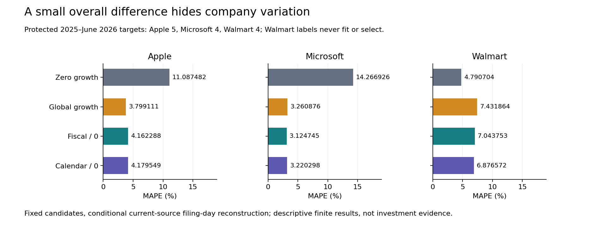

# Fiscal labels do not guarantee a better revenue forecast

Finance-data teams often align companies by fiscal quarter before forecasting. This study tests whether that choice improves a simple reported-revenue forecast over calendar-quarter grouping.

**Finding:** calendar pooling has 4.758807% macro MAPE and fiscal pooling 4.776929% on 13 protected test pairs. The small ordering changes across company and year checks. The validation winner was the zero-growth same-quarter baseline; the test is not used to replace that committed selection.

## Practical use

Retain actual report intervals, filing accessions and known-at-origin inputs. Test fiscal alignment against calendar grouping and a same-quarter baseline before adopting it. A current filing's fiscal focus must not be attached to its comparative prior-period facts.

Apple and Microsoft supply fitting/validation growth labels. Walmart is the company holdout; none of its growth labels fit or select. A 2024 growth-label embargo separates validation closure from the fixed 2025–June 2026 test origins. All fitting memberships, ten validation candidates, four test forecasters and company/year sensitivity accounts are retained.

## Run and inspect

~~~powershell
python -m pip install -r requirements.txt
python src/replay.py --out ../calendar-replay
python src/check_exercise.py
python src/verify_canonical_git.py
~~~

Use a new output directory. The [implementation exercise](EXERCISE.md) returns a qualified saved-cohort forecast or abstains on an incomplete slot/origin contract. It rejects unsupported financial claims and arbitrary caller-data certification.

- [Six-page manuscript](paper/manuscript.pdf), [complete metrics](results/test_metrics.csv), [every test forecast](results/test_predictions.csv) and [all sensitivity accounts](results/sensitivity.csv).
- [Numerical protocol](NUMERICAL_PROTOCOL.md), [26 actual frozen dependencies](PLAN_FREEZE.json), [validation selection](results/selection.json) and [complete source accounts](results/source_accounts.csv). Selection commit 771dfdb4c9a45fad55bc826be633f5ec13c1716d precedes the first protected test.
- Independent native checks: 373 revenue entries, 7,007 filing records, eight bodies and 38,426 conditions. Separate SQLite/Fraction reconstruction: 4,243 complete final conditions. All 32 boundary fixture methods and 23 exercise conditions pass.
- Full-history [CPython 3.10.11](results/reproduction_cpython310.json) and [3.12.14](results/reproduction_cpython312.json) replays reproduce 14 primary files byte for byte, preserving six source-directory files each. [Figures](figures/verification.json): 32 source-bound bars, 128 actual SVG coordinates and 395 conditions. [Paper](paper/verification.json): 90 used bindings, all 16 metric rows and 393 conditions; all six rendered pages inspected.

## Scope and limits

This is a conditional current-source filing-day reconstruction, not a verified immutable production point-in-time dataset. It uses one standardized concept, original 10-Q quarters Q1–Q3, three convenience companies and two test calendar years. It does not harmonize accounting policy, infer Q4, establish source truth or provide calibrated confidence intervals. No general predictive winner, investment advice, new estimator, scientific priority, causal effect, deployment or realized saving is claimed.

The [original proposal](ORIGINAL_PROPOSAL.md) and [source-only phase](PROTOCOL.md) are preserved as historical documents; the executed scope is the numerical protocol. Raw JSON, expressive corporate material, addresses, phone numbers and EINs stay private. Formal-publication projects including Azure optimization remain private.

Sources: [SEC EDGAR APIs](https://www.sec.gov/search-filings/edgar-application-programming-interfaces), with [exact capture metadata](data/capture_manifest.json); established benchmark/evaluation context from [Forecasting: Principles and Practice](https://otexts.com/fpp3/toolbox.html). MIT covers original code; third-party facts are attributed separately. Not peer reviewed.
